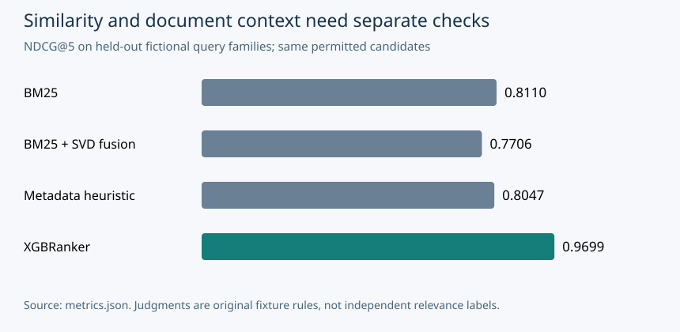

# Tree Search Ranker

A query about last year's policy can correctly rank an archived document first. The same document can be a poor answer to a question about today's policy. This experiment asks whether a small XGBoost ranker can distinguish the two intents after filtering documents by tenant, reader permissions and query time.

BM25, fusion and the tree all rank the same candidate pool. Fusion was selected on validation and remains the comparator even though BM25 did better on test. The judgments come from rules on a fictional corpus. [Per-query rankings](reports/per_query_test.csv) · [Held-out comparison](reports/case-study.md) · [Judgment rules](DATA_CARD.md)



## Reproduce it locally

Python 3.11 on CPU, no API keys, external dataset downloads or GPU needed. The pinned requirements select the official minimal `xgboost-cpu` package on Linux x86_64 and the general XGBoost wheel elsewhere. The executed development environment used the Windows wheel.

```bash
python -m venv .venv
# Windows: .venv\Scripts\activate
# macOS/Linux: source .venv/bin/activate
python -m pip install -r requirements.txt
python -m unittest discover -s tests -v
python run.py benchmark
```

The committed run uses XGBoost 3.1.2, scikit-learn 1.3.0, NumPy 1.26.0 and two XGBoost threads. The workflow pins its GitHub Actions to commit hashes and executes the tests, benchmark and a search smoke test. CI runs on Linux; the development run was executed on Windows.

```bash
python run.py search "current record retention approved procedure" --tenant birch
python run.py search "prior 2024 record retention procedure" --tenant birch
python run.py search "record retention manager exception" --tenant aster --principal manager
python run.py search "zqxwvp mnrbft" --tenant aster
```

The last example returns no candidates. `--principal` selects a fictional test scenario; it does not authenticate a user. A production service must obtain tenant/groups from a trusted identity layer, never from a user-supplied role flag.

Regenerate the original fixture or render the story from saved measurements:

```bash
python run.py generate
python run.py report
```

`benchmark` recreates `reports/ranker.json`, the metrics JSON, per-query CSV, feature-importance JSON, failure demonstrations and the generated story/chart. It selects the tree using validation labels before evaluating the test families. `report` changes no numerical evidence and performs no training.

## What is implemented

| Layer | Contract |
|---|---|
| Access/time scope | Same tenant, ACL/group intersection, latest update and availability at or before query time |
| Scoped index | BM25 statistics and TF-IDF/SVD fitted on permitted documents only |
| Candidate generation | Up to 20 BM25 plus 20 SVD candidates, deduplicated; same union for every method |
| Comparisons | BM25, reciprocal-rank fusion, transparent metadata heuristic, grouped XGBRanker |
| Features | 17 observable text/metadata values; label, family and ID fields excluded from model inputs |
| Supervision | Original graded fixture judgments, held in a separate qrels file |
| Split | Query families stay together across all tenants, roles and paraphrases; 8/3/3 families for train/validation/test |
| Selection | Depth 2/3 and 40/80 trees, chosen by validation NDCG@5 |
| Evaluation | Full eligible-corpus ideal NDCG@5, MRR@10 with grade>=2 relevant, candidate recall and per-query rows |
| Uncertainty | Paired bootstrap over three held-out query families, not over correlated paraphrases |
| Reviewability | Model JSON, feature names/importances and SHA-256 receipts for data, source and training arrays |

The corpus is a known static catalog. Held-out query families test whether learned feature interactions transfer to other query themes; they do not test unseen documents or unseen tenants. TF-IDF/SVD is a local statistical projection, not a transformer or pretrained embedding model. Feature importance describes the fitted model and does not identify causal drivers.

## What the synthetic judgments measure

The engineering problem is broader than choosing trees versus an LLM. I wanted to make access boundaries, candidate denominators, query intent, grouped training and release evidence inspectable. A tree can complement retrieval and text representations, but it cannot repair a forbidden candidate or establish that an answer generated downstream is correct.

The fictional judgments deliberately favor authority/status/intent compatibility. A good score on this fixture demonstrates that mechanism, not real search quality. The next useful evidence would be independent relevance judgments on a declared holdout, including ambiguous acronyms, answerless queries, permission changes and realistic latency constraints.

## Inspiration and sources

The [LinkedIn discussion](https://www.linkedin.com/posts/andresvourakis_xgboost-and-similar-tree-based-models-are-share-7523776256539029505-auas/) inspired the question. I checked the architecture framing against [Dropbox's primary account of Dash relevance labeling](https://dropbox.tech/machine-learning/llm-human-labeling-improving-search-relevance-dropbox-dash) and [XGBoost's grouped learning-to-rank documentation](https://xgboost.readthedocs.io/en/release_3.1.0/tutorials/learning_to_rank.html). No tutorial code, proprietary data or published performance number was copied. This implementation does not reproduce Dropbox's LLM-assisted labeling process.

Original code, fixture and reports are distributed under the [MIT License](LICENSE).
