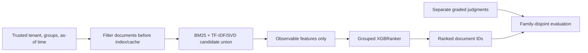
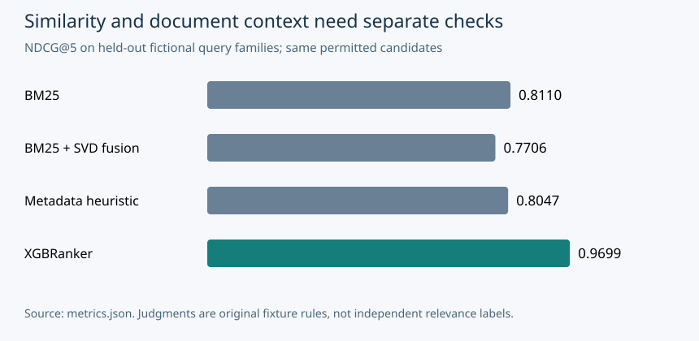

# The right document is not always the freshest string match

**An original independent reference implementation by Vedant Thaker, November 5, 2026.** It uses fictional documents and rule-authored judgments, not employer data or a reconstructed customer deployment.

My decision from this run: **Keep the tree as the next evaluation candidate, then collect independent judgments before any deployment.**

## First separate the topic from the decision

Enterprise search is a ranking problem before it becomes an answer-generation problem. The narrower question I test here is whether a small tree model can combine text similarity, document authority and a query's historical/current intent more effectively than a transparent retrieval baseline.

The decision is not whether to replace an LLM. There is no generative model, transformer embedding or LLM judge in this implementation. Text features are BM25, TF-IDF cosine and a locally fitted truncated-SVD projection. The last is a low-dimensional statistical text representation, not a pretrained semantic encoder.

## The usual first version answers only part of the request

A lexical ranker rewards overlapping words. A semantic-style channel can add candidate documents whose vocabulary differs. But neither similarity score, by itself, says whether an old procedure is being requested, whether a draft is authoritative, or whether a user is permitted to see the document.

I made those failure modes visible in an original fixture: approved procedures, keyword-heavy archives, drafts, discussions, manager-only exceptions and future documents. For a current query, a matching archive can be wrong. For a historical query, the same archive can be exactly the right result. A blanket freshness rule is therefore also an incomplete solution.

## My framework: scope, retrieve, represent, rank, audit

**Scope before indexing.** The document must belong to the query tenant, intersect the trusted principal's groups, and have both its availability and latest update no later than the query time. TF-IDF/SVD statistics and BM25 document frequencies are then fitted only within that permitted view. The cache key hashes that view's permitted contents and metadata; revocation and content updates change the key. In the fixture run, the framework produced **0 forbidden candidates** across all train, validation and test queries. This checks the implemented policy; it is not an authentication or security certification.

**Retrieve a common candidate set.** Each query takes up to 20 BM25 and 20 SVD-channel candidates, deduplicated. Every compared method ranks that same union. I calculate ideal NDCG from the entire eligible corpus, not just the retrieved candidates, so a candidate miss cannot disappear from the denominator.

**Represent observable evidence.** The ranker sees 17 named features derived from raw text and document metadata: lexical/TF-IDF/SVD similarity, title/body overlap, source authority, document age/status, and historical/manager words in the request. An explicit field allowlist excludes query IDs, family IDs, relevance grades and qrels. A mutation test changes hidden annotations without changing the feature matrix.

**Rank within query groups.** XGBoost learns a grouped `rank:ndcg` model, rather than pretending query-document rows are independent regression targets. I fixed four candidate configurations in advance, with depths 2/3 and 40/80 trees. Validation chose **depth 3, 80 trees** using full-eligible-corpus NDCG@5. The held-out test families were not used to choose hyperparameters. The best non-tree baseline on validation was **BM25 + SVD fusion**.

**Audit the claim.** The split keeps complete query families apart: 8 train, 3 validation and 3 test. All tenants, roles and paraphrases of a topic stay in its partition. Documents are a known static catalog; this is a held-out-query-family test, not an unseen-document or unseen-tenant test.

## What the executed experiment supports

All methods evaluated the same **72 test queries** from three held-out families. NDCG@5 uses gain `2^grade - 1`; MRR@10 treats grade 2 or 3 as relevant. Candidate recall is the fraction of all eligible grade>=2 documents present in the candidate union.

| Method | Mean NDCG@5 | Mean MRR@10 | Candidate recall |
|---|---:|---:|---:|
| BM25 | 0.8110 | 0.7882 | 1.0000 |
| BM25 + SVD fusion | 0.7706 | 0.7795 | 1.0000 |
| Metadata heuristic | 0.8047 | 0.8438 | 1.0000 |
| XGBRanker | 0.9699 | 1.0000 | 1.0000 |

The paired tree-minus-BM25 + SVD fusion NDCG difference is **+0.1993**, with a family-bootstrap 95% interval **[+0.1377, +0.2578]**. Resampling the 3 held-out families avoids treating paraphrases and tenant replicas as independent evidence. Three synthetic families are still a very weak basis for external generalization; the interval describes only this constructed fixture.

The baseline ordering also changed across splits: BM25 reached test NDCG@5 0.8110, while validation-selected fusion reached 0.7706. I retained the validation-selected comparison rather than choosing a favorable comparator after seeing the test. The table keeps every baseline visible.

The most important limit is in the labels themselves. This fixture was designed to make authority, status and historical intent matter, and its judgments were generated from that explicit rule contract. A successful tree fit demonstrates the implemented mechanism under those rules. It is not independent evidence that the ranker will improve real enterprise search.

## The failure demonstrations make the boundary reviewable

`failure_demos.json` deliberately compares a dangerous global BM25 index with the scoped candidate path. The unsafe path is used only for these demonstrations, never for training or the search CLI. Inspect its wrong-tenant hits beside the scoped path's forbidden-hit count. The tests separately exercise restricted/future documents, cache reuse after an ACL revocation, and hidden-annotation mutation.

`per_query_test.csv` preserves the scores, candidate denominators and top document/grade for each method. `feature_importance.json` is a model diagnostic, not a causal explanation. `metrics.json` records the training matrix, label, group, dataset, source and model SHA-256 digests, as well as the executed library versions.

## What I would do next

I would first collect an independent, human-reviewed judgment set that includes failed searches, ambiguous acronyms, answerless requests and stale but popular documents. I would declare the family/time split before looking at its holdout, compare the selected tree against the strongest existing baseline, and measure retrieval recall separately from reranking quality. Only after that would I test latency and relevance on a realistic serving workload.

The implemented impact is a reproducible way to challenge a ranking decision while preserving permission boundaries. There are no measured customer accuracy, latency-at-scale, CTR, revenue, or generated-answer claims. The CLI returns ranked fictional documents; it does not answer the user's business question or validate an LLM's response.

## Inspiration and primary references

The [supplied LinkedIn post](https://www.linkedin.com/posts/andresvourakis_xgboost-and-similar-tree-based-models-are-share-7523776256539029505-auas/) prompted the project topic. I checked the technical framing against [Dropbox's account of Dash relevance labeling and XGBoost ranking](https://dropbox.tech/machine-learning/llm-human-labeling-improving-search-relevance-dropbox-dash) and [XGBoost's learning-to-rank documentation](https://xgboost.readthedocs.io/en/release_3.1.0/tutorials/learning_to_rank.html). Those sources motivate the architecture; no source code, customer data, scale claims or published results were copied. In particular, Dropbox's LLM-assisted label workflow is not implemented or evaluated here.
